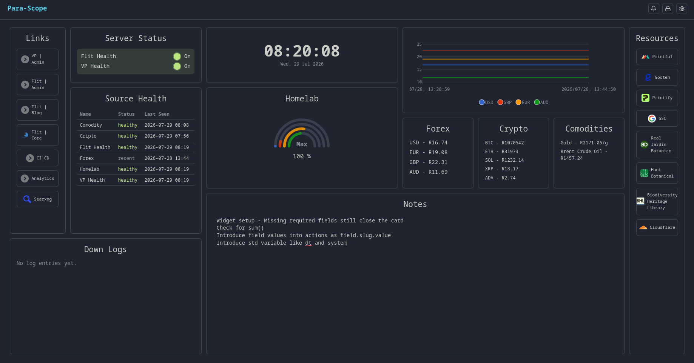
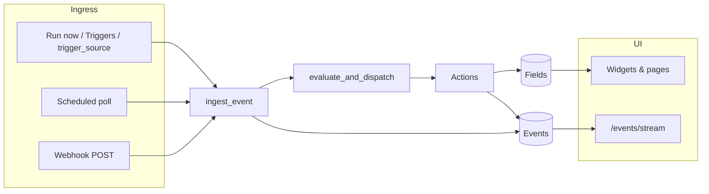

# Para-Scope

Self-hosted **event hub** and **dashboard**: webhooks and scheduled polls flow through rules into actions, with shared **Fields** driving a modular UI. One Python process, SQLite, no Docker requirement.

**0.1.3** · [Changelog](CHANGELOG.md) · [Releases](https://github.com/MrBlindMouse/para_scope/tags)



[Product overview](https://para-scope.bmd-studios.com) · [Operator guide](docs/guide.md) · [Design](DESIGN.md)

## What it is

Para-Scope is for individuals and small teams who want a private control plane: ingest events, filter them, update durable state, notify downstream systems, and see the result on a dashboard. It is intentionally **not** Prometheus/Grafana, n8n, or a multi-tenant SaaS.

| Area | Summary |
|------|---------|
| **Ingress** | Webhooks (provider verification) + in-process pollers (APScheduler) |
| **Pipeline** | Per-source event types, rules with conditions, ordered actions |
| **State** | Global Fields (logbook, value, text, toggle, data) used by actions and widgets |
| **UI** | Main dashboard + named **pages** (widget grid, calendar week, kanban) |
| **Productivity** | Read-only ICS feed → focus modes → optional kanban cards via rules |
| **Auth** | Cookie sessions, CSRF; single worker; config in SQLite |

## Stack

Python 3.11+ · FastAPI · SQLAlchemy (SQLite) · Jinja2 · HTMX · vanilla CSS · GridStack · ApexCharts

## Architecture

One process owns HTTP (dashboard, config, webhooks), in-process polling (**APScheduler**), and the event pipeline. Runtime config lives in **SQLite**; the repo is code, Jinja templates, and static assets. Assume a **single worker** (rate limits, scheduler, and SSE fan-out are in-memory).



**Pipeline.** Each **Source** (webhook or poll) owns event types and **Rules**. Rules match event types and optional payload conditions, then run ordered **Actions** (`field_push`, `http_forward`, `notify`, `web_push`, `local_script`, `kanban_push`, …). Rules are stateless; durable state goes to **Fields** (logbook, value, text, toggle, data) and the event log. Nested `trigger_source` / Triggers cascades share a depth ceiling of **3**.

**Dashboard.** Layout and widgets read Fields via `widgets.fetch_widget_data`. Named **pages** add kinds: widget grid (default), read-only **calendar** (ICS import), or **kanban** (columns/cards). Calendar sync uses the `ics_calendar` poller → `calendar_sync` → synthetic events; `kanban_push` creates cards from rules—user moves emit `card.moved` and are not overwritten by sync.

| Layer | Entry points |
|-------|----------------|
| Ingress | `app/ingest.py`, `app/pollers.py`, `app/routers/webhook.py` |
| Pipeline | `app/pipeline.py` |
| Actions / Fields | `app/actions.py`, `app/fields.py` |
| UI | `app/routers/dashboard.py`, `app/widgets.py`, `app/dashboard_layout.py` |

More detail: [DESIGN.md §5](DESIGN.md#5-high-level-architecture) and the layer table in [AGENTS.md](AGENTS.md#architecture).

## Quick start

```bash
uv venv .venv && uv pip install -r requirements.txt -p .venv
source .venv/bin/activate
cp .env.example .env   # PARA_SCOPE_SECRET_KEY required (openssl rand -hex 32)
uvicorn app.main:app --reload
```

First visit → `/setup`. Schema is created on boot (`create_all` only — **no migrations**; see [CHANGELOG](CHANGELOG.md) before upgrading).

## Documentation

| Document | For |
|----------|-----|
| [docs/guide.md](docs/guide.md) | Install, environment, webhooks, polling, capabilities, production |
| [DESIGN.md](DESIGN.md) | Vision, architecture, shipped vs planned |
| [AGENTS.md](AGENTS.md) | Hard constraints for humans and agents (PRs, AI edits) |
| [docs/authoring.md](docs/authoring.md) | Adding a built-in poller, action, or widget |
| `/help` (in app) | UI-oriented reference after login |

## Development

```bash
source .venv/bin/activate
pytest app/tests/ -v
```

Read [AGENTS.md](AGENTS.md) before structural changes. Local tree layout and invariants are also documented in nested `AGENTS.md` files under `app/`.

## License

[MIT](LICENSE)
